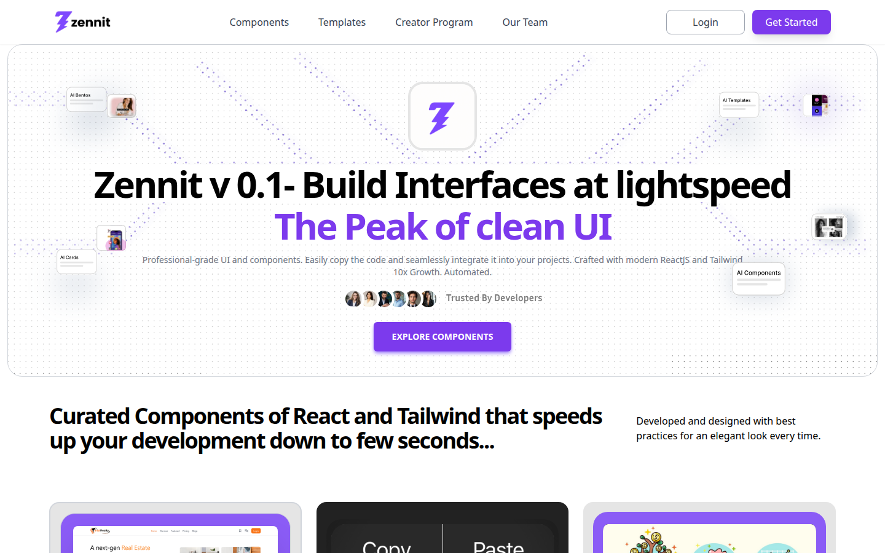
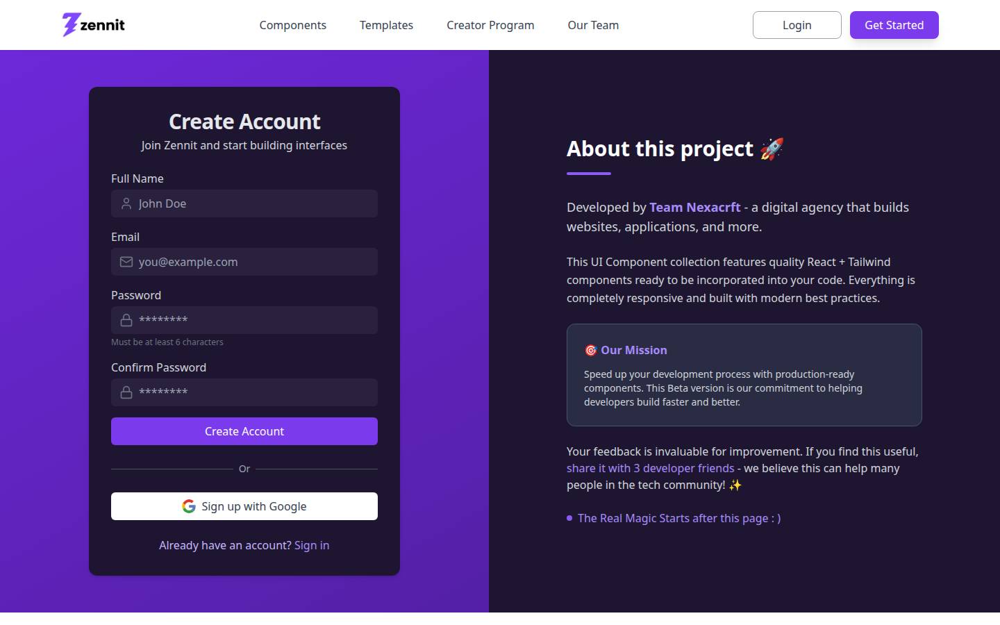
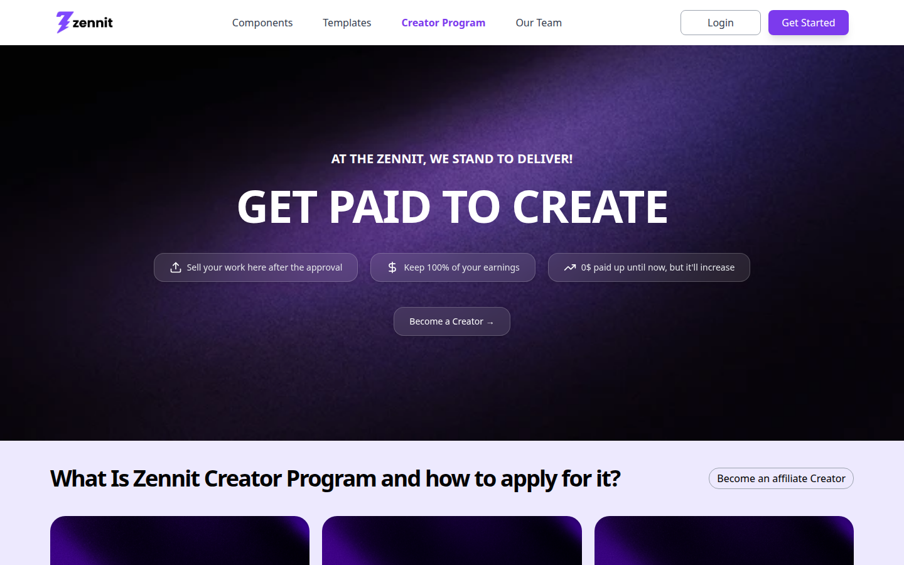

<div align="center">

# ⚡ Zennit

**A SaaS marketplace of production-ready React + Tailwind UI components and website templates, with one-click copy-paste.**

Sold at a **$1.5M valuation** · Role: **Founding Engineer**

`React` · `Node.js` · `Express` · `MongoDB` · `Tailwind CSS` · `Razorpay` · `Cloudinary` · `Vercel` · `Render`

</div>

> 🔒 The source code is in a private repository because the product was sold. I'm happy to walk through the code and architecture in an interview.

---

## 🎬 Demo

<!-- Drag and drop your demo video (.mp4, max 10 MB) here when editing this file on GitHub,
     or replace this line with an unlisted YouTube link:
     [](https://youtu.be/YOUR_VIDEO_ID) -->


https://github.com/user-attachments/assets/0d0909e1-4d7c-4c68-8ef6-45551bd3db6f


---

## What Zennit does

Developers browse a library of UI sections (heroes, pricing tables, FAQs, navbars, bento grids and more) and copy each one into their own project **in one click**. Free components are open to everyone. Premium components and full website templates are unlocked through paid subscription plans. Outside developers can apply to the **Creator Program** to publish their own components.

## Key features

| Feature | What I built |
|---|---|
| **One-click copy-paste** | Copying uses the Clipboard API and is gated by the user's subscription tier. Users who aren't logged in are redirected to the login page, which remembers the component they wanted. Every copy is tracked for analytics. |
| **Subscriptions & payments** | Razorpay checkout with server-side **HMAC-SHA256 signature verification** and payment-amount checks before access is unlocked. Plans give tiered access to components and templates. |
| **Authentication** | JWT sessions, bcrypt password hashing, **email OTP verification** and password reset (Nodemailer), and **Google OAuth 2.0** (Passport.js). |
| **Admin dashboard** | Manage components, templates, users, subscription plans and creator applications, with **revenue and component-usage analytics** built on MongoDB aggregation pipelines and charted with Recharts. |
| **Creator Program** | An application workflow for outside developers to submit components, reviewed by admins. |
| **Media** | Image uploads through Multer, stored on Cloudinary. |

## Architecture

```
┌──────────────────────┐   REST / JSON   ┌──────────────────────┐      ┌───────────┐
│  React + Vite SPA    │ ──────────────► │  Node.js + Express   │ ───► │  MongoDB  │
│  Tailwind, Framer    │   JWT auth      │  50+ API endpoints   │      │  8 models │
│  Motion, React       │ ◄────────────── │  9 route modules     │      └───────────┘
│  Router, Context API │                 │                      │ ───► Razorpay · Cloudinary
└──────────────────────┘                 └──────────────────────┘ ───► Gmail SMTP · Google OAuth
      Vercel                                   Render
```

**Data models:** User, Component, Template, SubscriptionPlan, Purchase, ComponentCopy (copy analytics), CreatorApplication, OTP

## Screenshots

| Sign up (email OTP + Google OAuth) | Creator Program |
|---|---|
|  |  |

<div align="center">

**Interested in the code or a walkthrough?** Contact me on [LinkedIn](https://linkedin.com/in/YOUR-PROFILE) or by [email](mailto:YOUR-EMAIL).

</div>
